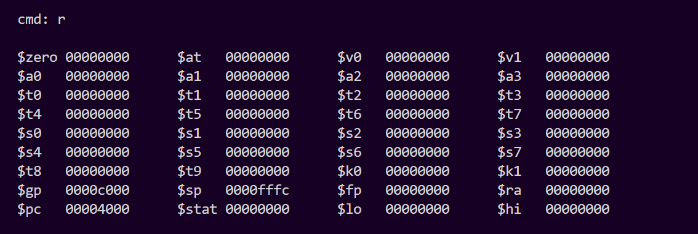
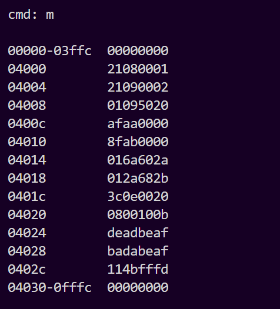
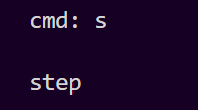
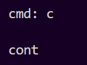
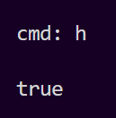
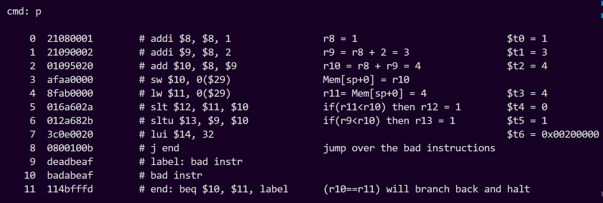
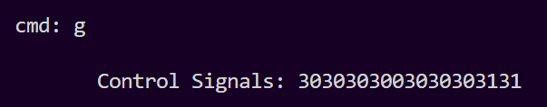
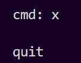

**Collaboration:**
  ```
  git clone https://github.com/ProgrammingStuff11/MySPIM.git
  ```

**Get Latest Changes**
  ```
  git pull
  ```

**Commit your Changes**
  ```
  git add .
  git commit -m "Describe your changes"
  ```

**Push Changes**
  ```  
  git push
  ```

**Run Code**
  ```
  Open the terminal and run the following lines in bash:
  
  $ gcc -o spimcore spimcore.c project.c
  $ ./spimcore <filename>.asc
  ``` 
**Output based on each command**
```
r: “Register” - Display register contents
```


```
m: “Memory” - Display memory contents
```


```
s: “Step” – Attempt to run the instruction located at the current PC
```


```
c: “Continue” – Attempt to run all instructions, beginning with PC
```


```
h: “Halt” – Check to see if the simulation has halted
```


```
p: “Print” – Prints a copy of the input file
```


```
g: “Controls” – Display the most recent control signals
```


```
x: “Quit” – terminate the simulation
```
